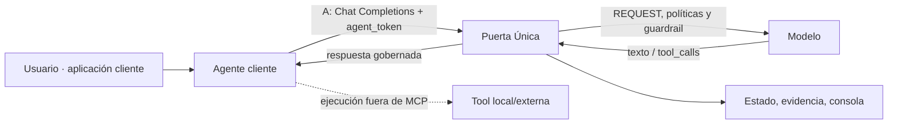
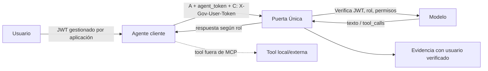
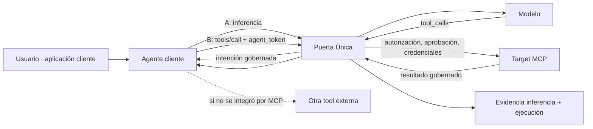
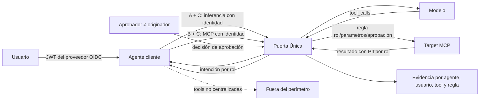

# Arquitecturas conceptuales por combinación de conexiones

**Fuente:** exclusivamente `insumo/` de [agentic-ai-governance-platform, rama u13-s0-otlp](https://github.com/enzo-loren/agentic-ai-governance-platform/tree/u13-s0-otlp/insumo). **Objeto:** describir el producto objetivo (Módulo A) independientemente del grado de implementación, del stack desplegado y de la ingeniería descubierta en los spikes. **Fecha:** 2026-11-08.

La plataforma ofrece una sola Puerta Única. Las cuatro arquitecturas no son cuatro stacks ni cuatro productos: son cuatro **configuraciones de integración** que delimitan qué puede observar y controlar el perímetro sobre *cada solicitud y cada herramienta*. A es obligatoria; B y C se pueden sumar en cualquier orden y de forma parcial.

## 1. Semántica común

| Conexión | Integración por el cliente | Qué obtiene el perímetro | Cómo se observa la cobertura |
|---|---|---|---|
| **A – inferencia** | `BASE_URL={gateway}/inference/v1`, `api_key=agent_token`; OpenAI Chat Completions | Solicitud y respuesta de modelo, herramientas declaradas, intenciones `tool_calls`, reglas sobre intención, seguridad de contenido, presupuesto y evidencia | Tráfico de inferencia en ventana |
| **B – MCP** | Publicar tools como targets MCP y llamarlas desde `{gateway}/mcp` con el mismo `agent_token` | Ejecución **real** del target cuando atraviesa el Gateway; estado de aprobación, credenciales, argumentos, resultado, HITL | `tools_declaradas_que_pasan_por_MCP / tools_declaradas` |
| **C – identidad** | Reenviar `X-Gov-User-Token` del usuario **en inferencia y en MCP cuando corresponda** | JWT verificado; identidad/rol, límites personales, `pii_access`, atribución y reglas por usuario | `solicitudes_con_token_válido / solicitudes_del_agente` |

El salto **usuario → agente no pasa por el perímetro de gobernanza**. C valida el JWT suministrado, pero no demuestra por sí misma que el agente actúe en representación correcta del usuario. El agente que puede eludir la puerta vía credenciales y red propias sigue siendo responsabilidad del cliente. El aviso de IA en la UI del usuario final tampoco se resuelve desde la plataforma (CTRL-25/26/27).

**Lógica transversal en todas las combinaciones:** autenticación del agente, modo descubrimiento inicial con evaluaciones en sombra según control, modo activo con políticas Cedar y falla cerrada, modelos permitidos, guardrail sobre segmentos del usuario y salida de modelo, detector de PII en salidas, catálogo de tools, límite y costo, eventos y evidencia. **Inferencia** y **MCP** son canales distintos del mismo perímetro. El estado y las decisiones son administrados por consola; evidencia durable indexada y copia S3 Object Lock GOVERNANCE. El Módulo B es un agente sintético separado, no pieza obligatoria del producto.

## 2. Vista A — Solo inferencia

**Principal:** `solo_workload` (agente), no usuario. **Sí:** inventario de tools vistas en prompts y respuestas; modelos, consumo y límites del agente; evaluación/bloqueo de *intención* en `tool_calls`; datos personales sobre texto del modelo; registro. **No:** la puerta no puede observar directamente ni gobernar la ejecución de una tool fuera de MCP. Si el resultado de la tool vuelve al modelo, puede verse en una inferencia posterior, pero eso **no es control previo de ejecución**.

En modo activo, un `tool_call` denegado puede suprimirse de la respuesta; esa medida no impide que el agente ejecute una herramienta mediante otro camino. Un requerimiento de aprobación sobre una tool sin MCP se bloquea con mensaje de conexión B requerida; no crea una aprobación ejecutable fuera de la puerta.

## 3. Vista A+C — Inferencia con identidad del usuario

**Principal:** usuario verificado **si se envía JWT válido**; de lo contrario `solo_workload` o rechazo, según configuración y modo. **Añade:** decisiones por rol sobre la *intención*, límites y costos por usuario, `pii_access` sobre respuestas, evidencia y ruta forense por usuario. **No añade:** control de ejecución de una tool local. C no exige tener B.

## 4. Vista A+B — Inferencia y tools por MCP

**Principal:** `solo_workload` (agente). **Añade:** control de ejecución de targets MCP, aprobación y clasificación de tools, evaluación de parámetros, bóveda de credenciales, protección de resultados, evidencia de ejecución, suspensión en ambos canales. Puede existir supervisión humana con originador = agente; sin C **no hay autorización según roles del usuario final** ni separación de funciones personalizada. Si una tool no usa B, continúa fuera de la puerta. **No afirmar que A+B equivale a A+B+C**: Preset 2, por ejemplo, deniega escritura/destructivas cuando exige usuario identificado.

## 5. Vista A+B+C — Inferencia, tools e identidad

**Principal:** usuario verificado si llega JWT válido. **Añade a A+B:** política por rol sobre ejecución **y** sobre intención, cuotas por usuario, PII por rol en respuestas de modelos y tools, ruta forense por persona y separación de funciones (HITL). La aprobación humana se crea **cuando la tool permitida cruza MCP** y necesita aprobación; devolver `PENDING_APPROVAL`, consultar con `gov_aprobacion_estado`, exigir actor aprobador distinto y ejecutar una sola vez son requisitos del producto, no comportamientos implícitos de tener las tres conexiones.

## 6. Matriz de alcance (no confundir con cantidad de servicios AWS)

| Capacidad | A | A+C | A+B | A+B+C |
|---|---|---|---|---|
| Inferencia/modelos/intención/guardrail/PII de modelo | ✓ | ✓ | ✓ | ✓ |
| Usuario verificado, rol, límite individual | — | ✓* | — | ✓* |
| Ejecución real de tools por puerta | — | — | ✓* | ✓* |
| Reglas por parámetros de una ejecución | — | — | ✓* | ✓* |
| Datos personales en resultado directo de tool | solo retorno vía modelo | solo retorno vía modelo | ✓* | ✓* por rol |
| Aprobación humana MCP | — | — | ✓ (originador agente) | ✓ (originador usuario + separación de funciones) |
| Evidencia por usuario | — | ✓* | — | ✓* |
| Kill Switch en ambos canales | solo canal inferencia | solo canal inferencia | ✓* | ✓* |

`✓*` significa **solo en la parte efectivamente conectada** (tool MCP o solicitud con JWT válido). No supone conexión universal.

## 7. Índice del catálogo (ejemplo canónico)

Para agente con **tools y usuarios humanos**, conexiones presentes **completas**, controles evaluados con evidencia y catálogo actual de `requisitos.yaml`:

| Combinación | Modo activo | Descubrimiento |
|---|---:|---:|
| A | 41 % | 33 % |
| A+C | 56 % | 44 % |
| A+B | 67 % | 48 % |
| A+B+C | 89 % | 59 % |

Son puntos del **índice de cobertura del catálogo**, no un score absoluto de seguridad ni garantía de prevención. Máximo 89 % porque CTRL-25–27 están fuera del perímetro. Cuando faltan tools/usuarios o hay cobertura parcial/falla de evidencia, se usa la fórmula de [01-modelo-de-conexion §3](https://github.com/enzo-loren/agentic-ai-governance-platform/blob/u13-s0-otlp/insumo/contexto/01-modelo-de-conexion.md), no estos valores como constantes.

## 8. Relación conceptual con servicios AWS (no implica diseño final de infraestructura)

| Capacidad | Servicio previsto por `insumo/` |
|---|---|
| Puerta Única de inferencia y MCP, interceptores | Amazon Bedrock AgentCore Gateway; lógica de gobierno Lambda |
| Modelos y guardrails de contenido | Amazon Bedrock + ApplyGuardrail; simulado opcional |
| Salida a targets MCP y credenciales | AgentCore Gateway + AgentCore Identity, targets Lambda/OpenAPI |
| Identidad administrativa y validación OIDC | Amazon Cognito para usuarios de consola; emisor usuario configurable |
| Índice de solicitudes, agentes, límites, versiones | DynamoDB |
| Evidencia bajo retención | S3 Object Lock GOVERNANCE + mecanismo de copia asíncrona |
| API de consola y UI web | API Gateway REST + Lambda + React/Cloudscape |
| Reglas | Motor Cedar integrado en lógica de interceptores (no AgentCore Policy en MVP) |

La elección de fachada, WAF, cantidades de recursos, timeout, topología VPC, costos y estado actual de las ramas **no son parte de estas cuatro arquitecturas lógicas**. Se documentan por separado en [auditoría de implementación](arquitectura-aws-auditada.md).

## 9. Referencias canónicas por afirmación

- [`insumo/index.md`](https://github.com/enzo-loren/agentic-ai-governance-platform/blob/u13-s0-otlp/insumo/index.md): jerarquía de fuentes.
- [`insumo/requisitos.yaml`](https://github.com/enzo-loren/agentic-ai-governance-platform/blob/u13-s0-otlp/insumo/requisitos.yaml): requisitos y controles oficiales.
- [`insumo/contexto/01-modelo-de-conexion.md`](https://github.com/enzo-loren/agentic-ai-governance-platform/blob/u13-s0-otlp/insumo/contexto/01-modelo-de-conexion.md): las cuatro combinaciones, medición de A/B/C, cobertura parcial y límites del perímetro.
- [`insumo/contexto/02-contrato.md`](https://github.com/enzo-loren/agentic-ai-governance-platform/blob/u13-s0-otlp/insumo/contexto/02-contrato.md): Chat Completions, MCP, cabeceras, respuestas, evidencia y PII.
- [`insumo/contexto/03-politicas-y-estado-inicial.md`](https://github.com/enzo-loren/agentic-ai-governance-platform/blob/u13-s0-otlp/insumo/contexto/03-politicas-y-estado-inicial.md): modos, Presets Cedar, diferencias por combinación.
- [`insumo/contexto/catalogo-controles.md`](https://github.com/enzo-loren/agentic-ai-governance-platform/blob/u13-s0-otlp/insumo/contexto/catalogo-controles.md): catálogo y índices por combinación (derivado del YAML).
- [`insumo/contexto/05-decisiones-tecnicas.md`](https://github.com/enzo-loren/agentic-ai-governance-platform/blob/u13-s0-otlp/insumo/contexto/05-decisiones-tecnicas.md): servicios de referencia para arquitectura lógica.

**Criterio de mantenimiento:** cambiar estas cuatro vistas solo cuando cambie el `insumo/` canónico; no hacerlo por cambios en la rama de implementación. Si el requisito y su derivado discrepan, prevalece `requisitos.yaml`.
